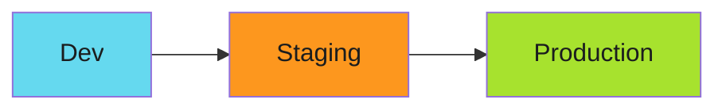

# Environment Progression Testing: Dev → Stage → Prod Validation

The deployment worked in dev. Unit tests passed. Code review approved. Merged to main.

Production exploded.

The config used a dev secret. Migration locked tables at scale. Feature flag on in staging. Off in prod.

Environmental differences killed us.

<!-- more -->

---

## The Illusion of "It Works on My Machine"

Every environment is different:

| Aspect | Dev | Staging | Production |
| ------ | --- | ------- | ---------- |
| Scale | 1 pod | 3 pods | 50 pods |
| Data | Synthetic | Sanitized prod copy | Real data |
| Secrets | Shared dev keys | Staging keys | Prod keys |
| Network | Permissive | Restricted | Locked down |
| Load | Developer testing | Automated tests | Real traffic |

Code passes in dev. It fails in production. The environments aren't the same.

!!! warning "Environmental Parity Problem"
    Dev, staging, and production are never identical. Progressive deployment catches issues early. Production never sees them.

---

## Progressive Deployment Strategy

Test in each environment sequentially.

Three jobs run in order: `deploy-dev`, `deploy-staging`, `deploy-production`.
Each applies the manifests to its namespace and runs a smoke test against that environment's URL.
The production job waits for an approval through a GitHub `environment`.
The [environment progression pipeline guide](../../patterns/architecture/environment-progression-pipeline.md) has the workflow.

Dev fails? Staging blocked. Staging fails? Production blocked.

---

## Smoke Tests That Matter

Smoke tests validate critical paths.

The script checks four things and exits 1 on the first failure: the `/healthz` endpoint, a version from `/api/version`, database connectivity from `/api/db-status`, and one critical POST action.

Not comprehensive tests. Just basic health checks.

---

## Namespace Strategy

One cluster, multiple namespaces.

Three namespaces, `development`, `staging` and `production`, each labelled with its `environment`.

NetworkPolicies enforce isolation.

A default `NetworkPolicy` in `production` allows ingress only from namespaces labelled `environment: prod`.
The [guide](../../patterns/architecture/environment-progression-pipeline.md) has the script, the namespaces and the policy.

Production pods can't talk to dev pods. Boundaries enforced.

---

## Configuration Management

---

See **[Environment Progression Testing Guide](../../patterns/architecture/environment-progression.md)** for:

- Argo CD configurations
- Smoke test patterns
- Namespace strategies

---

## Related Patterns

- **[Strangler Fig Pattern](../../patterns/architecture/strangler-fig/index.md)** - Incremental system migration
- **[SDLC Hardening](2025-12-12-harden-sdlc-before-audit.md)** - Security across environments
- **[Policy-as-Code](2025-12-13-policy-as-code-kyverno.md)** - Runtime validation

---

*The staging environment caught the breaking change. Production never saw it. The deployment succeeded. The customers never knew.*
