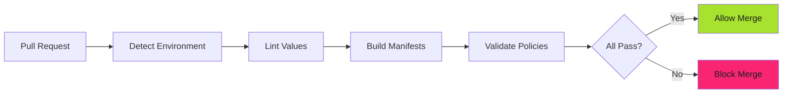

# CI Integration: Automated Policy Enforcement

Block non-compliant code at merge time. Same container as local dev, zero configuration drift.

## Overview

CI integration enforces policies automatically in every pull request using the **same policy-toolkit container** developers run locally.



**Key Principle**: CI uses identical validation to local development. No surprises.

---

## Pipeline Architecture

### Environment Detection

Policy validation is environment-specific. Detect target environment from branch:

```yaml
- step:
    name: Detect Environment
    script:
      - |
        if [ -n "$BITBUCKET_PR_ID" ]; then
          # Pull Request - check destination branch
          case $BITBUCKET_PR_DESTINATION_BRANCH in
            "development") ENVIRONMENT="dev" ;;
            "qa")          ENVIRONMENT="qa" ;;
            "staging")     ENVIRONMENT="stg" ;;
            "production")  ENVIRONMENT="prd" ;;
            *)
              echo "Unknown destination branch"
              exit 0
              ;;
          esac
        else
          # Direct push - check current branch
          case $BITBUCKET_BRANCH in
            "development") ENVIRONMENT="dev" ;;
            "qa")          ENVIRONMENT="qa" ;;
            "staging")     ENVIRONMENT="stg" ;;
            "production")  ENVIRONMENT="prd" ;;
          esac
        fi
        echo "export ENVIRONMENT=${ENVIRONMENT}" > environment.sh
    artifacts:
      - environment.sh
```

!!! warning "Environment Detection is Critical"
    Production policies are stricter than dev. Wrong environment detection means applying dev policies to production code. This creates security gaps.

---

## Pipeline Stages

### Stage 1: Schema Validation

Validate Helm values against schemas **before** rendering manifests:

```yaml
- step:
    name: Lint Values Against Schema
    image: policy-toolkit:latest
    script:
      - source environment.sh
      - |
        # Merge base values + environment values
        yq eval-all 'select(fileIndex == 0) * select(fileIndex == 1)' \
          /repos/service-charts/charts/backend-app/values.yaml \
          ./cd/values.${ENVIRONMENT}.yaml \
        > combined_values.yaml

      - |
        # Validate merged values against schema
        spectral lint \
          -r /repos/service-charts/.spectral.yaml \
          combined_values.yaml
```

**Catches**:

- Missing required fields
- Type mismatches
- Invalid enum values

**Fails fast**: no point rendering manifests if values are invalid.

---

### Stage 2: Manifest Rendering

Render environment-specific manifests:

```yaml
- step:
    name: Build Environment Manifests
    image: policy-toolkit:latest
    script:
      - source environment.sh
      - |
        # Define chart paths
        sec_pol_chart=/repos/security-rules/charts/security-rules
        dev_pol_chart=/repos/ops-rules/charts/ops-rules
        be_apps_chart=/repos/service-charts/charts/service-charts

      - |
        # Render DevOps policies
        helm template ops-rules ${dev_pol_chart} \
          -f ${dev_pol_chart}/values.yaml \
          -f /repos/ops-rules/cd/values.yaml \
          -f /repos/ops-rules/cd/${ENVIRONMENT}/values.yaml \
        > ops-rules.yaml

      - |
        # Render Security policies
        helm template security-rules ${sec_pol_chart} \
          -f ${sec_pol_chart}/values.yaml \
          -f /repos/security-rules/cd/values.yaml \
          -f /repos/security-rules/cd/${ENVIRONMENT}/values.yaml \
        > security-rules.yaml

      - |
        # Render application manifests
        helm template backend-app ${be_apps_chart} \
          -f ${be_apps_chart}/values.yaml \
          -f ./cd/values.${ENVIRONMENT}.yaml \
        > backend-app.yaml

    artifacts:
      - ops-rules.yaml
      - security-rules.yaml
      - backend-app.yaml
```

**Three artifact types**:

1. **security-rules.yaml** for Security rules (resource limits, image policies, etc.)
2. **ops-rules.yaml** for Operational rules (labels, annotations, naming)
3. **backend-app.yaml** for Application manifests to validate

---

### Stage 3: Policy Validation (Parallel)

Validate against DevOps and Security policies **in parallel**:

```yaml
- parallel:
    steps:
      - step:
          name: Validate Ops Rules
          image: policy-toolkit:latest
          script:
            - |
              # Generate policy report
              kyverno apply ops-rules.yaml \
                --resource backend-app.yaml \
                --output mutated-resources \
                --policy-report \
                --audit-warn \
              > tmp-policy-report.yaml

            - |
              # Extract YAML report for download
              sed -n '/^POLICY REPORT:/,$p' tmp-policy-report.yaml \
                | tail -n +3 \
                | { echo '---'; cat; } \
              > policy-report.yaml

            - |
              # Display summary
              kyverno apply ops-rules.yaml \
                --resource backend-app.yaml \
                --output mutated-resources \
                --remove-color

            - |
              # Display detailed results table
              kyverno apply ops-rules.yaml \
                --resource backend-app.yaml \
                --output mutated-resources \
                -t --detailed-results \
                --remove-color
          artifacts:
            - policy-report.yaml

      - step:
          name: Validate Security Policy
          image: policy-toolkit:latest
          script:
            - |
              kyverno apply security-rules.yaml \
                --resource backend-app.yaml \
                --output mutated-resources \
                --policy-report \
                --audit-warn \
              > tmp-policy-report.yaml

            - sed -n '/^POLICY REPORT:/,$p' tmp-policy-report.yaml \
                | tail -n +3 \
                | { echo '---'; cat; } \
              > policy-report.yaml

            - kyverno apply security-rules.yaml \
                --resource backend-app.yaml \
                --output mutated-resources \
                --remove-color

            - kyverno apply security-rules.yaml \
                --resource backend-app.yaml \
                --output mutated-resources \
                -t --detailed-results \
                --remove-color
          artifacts:
            - policy-report.yaml
```

!!! tip "Parallel Validation Saves Time"
    DevOps and Security policies are independent. Running them in parallel cuts pipeline time in half. Both must pass for merge approval.

**Artifacts**: Policy reports downloadable for detailed review.

---

## Complete Bitbucket Pipeline

Full pipeline showing all stages:

```yaml
image:
  name: policy-toolkit:main
  username: _json_key
  password: "$GCLOUD_API_KEYFILE"

pipelines:
  pull-requests:
    '**':
      # Stage 1: Detect environment from PR destination
      - step:
          name: Detect Environment
          script:
            - |
              case $BITBUCKET_PR_DESTINATION_BRANCH in
                "development") ENVIRONMENT="dev" ;;
                "qa")          ENVIRONMENT="qa" ;;
                "staging")     ENVIRONMENT="stg" ;;
                "production")  ENVIRONMENT="prd" ;;
                *)
                  echo "Unknown branch. Skipping."
                  exit 0
                  ;;
              esac
              echo "export ENVIRONMENT=${ENVIRONMENT}" > environment.sh
          artifacts:
            - environment.sh

      # Stage 2: Validate Helm values schema
      - step:
          name: Lint Values Schema
          script:
            - source environment.sh
            - yq eval-all 'select(fileIndex == 0) * select(fileIndex == 1)' \
                /repos/service-charts/charts/backend-app/values.yaml \
                ./cd/values.${ENVIRONMENT}.yaml \
              > combined_values.yaml
            - spectral lint -r /repos/service-charts/.spectral.yaml \
                combined_values.yaml

      # Stage 3: Render manifests
      - step:
          name: Build Manifests
          script:
            - source environment.sh
            - helm template ops-rules \
                /repos/ops-rules/charts/ops-rules \
                -f /repos/ops-rules/charts/ops-rules/values.yaml \
                -f /repos/ops-rules/cd/${ENVIRONMENT}/values.yaml \
              > ops-rules.yaml
            - helm template security-rules \
                /repos/security-rules/charts/security-rules \
                -f /repos/security-rules/charts/security-rules/values.yaml \
                -f /repos/security-rules/cd/${ENVIRONMENT}/values.yaml \
              > security-rules.yaml
            - helm template backend-app \
                /repos/service-charts/charts/backend-app \
                -f /repos/service-charts/charts/backend-app/values.yaml \
                -f ./cd/values.${ENVIRONMENT}.yaml \
              > backend-app.yaml
          artifacts:
            - ops-rules.yaml
            - security-rules.yaml
            - backend-app.yaml

      # Stage 4: Validate policies (parallel)
      - parallel:
          steps:
            - step:
                name: Ops Rules
                script:
                  - kyverno apply ops-rules.yaml \
                      --resource backend-app.yaml \
                      --policy-report --audit-warn \
                    > tmp-report.yaml
                  - kyverno apply ops-rules.yaml \
                      --resource backend-app.yaml \
                      --remove-color
                  - kyverno apply ops-rules.yaml \
                      --resource backend-app.yaml \
                      -t --detailed-results --remove-color
                artifacts:
                  - tmp-report.yaml

            - step:
                name: Security Policy
                script:
                  - kyverno apply security-rules.yaml \
                      --resource backend-app.yaml \
                      --policy-report --audit-warn \
                    > tmp-report.yaml
                  - kyverno apply security-rules.yaml \
                      --resource backend-app.yaml \
                      --remove-color
                  - kyverno apply security-rules.yaml \
                      --resource backend-app.yaml \
                      -t --detailed-results --remove-color
                artifacts:
                  - tmp-report.yaml
```

!!! note "Policy Report Artifacts"
    Each validation step generates a `policy-report.yaml` artifact. Download these for detailed offline review and compliance tracking.

---

## Next Steps

- **[GitHub Actions Integration](github-actions.md)** for GitHub Actions workflow examples
- **[Runtime Deployment](../runtime-deployment/index.md)** for Deploy Kyverno admission control
- **[Multi-Source Policies](../multi-source-policies/index.md)** for Aggregate multiple policy repos
- **[Operations](../operations/index.md)** for Day-to-day policy management
